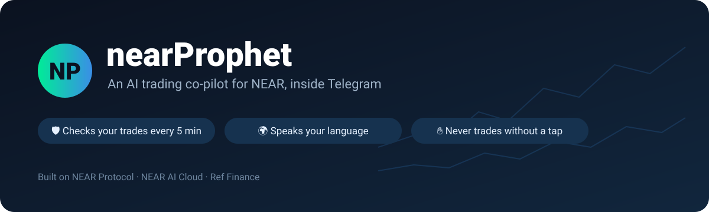
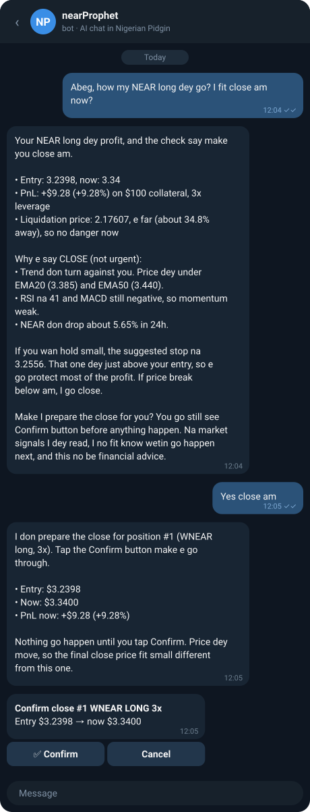
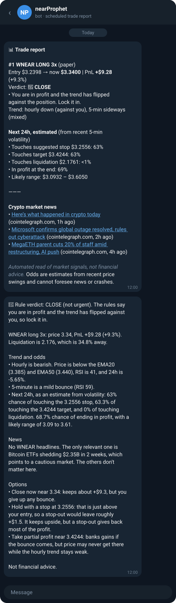
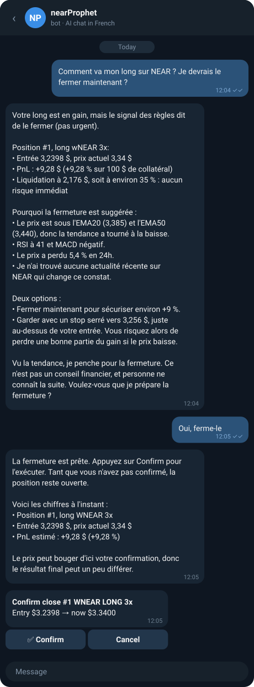
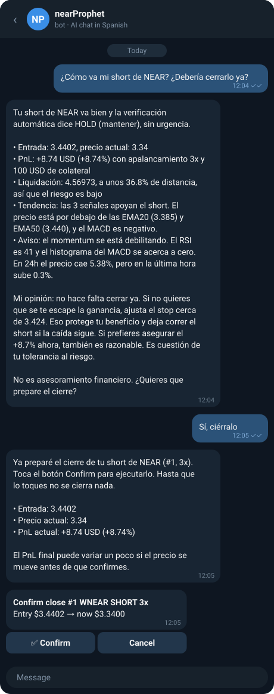
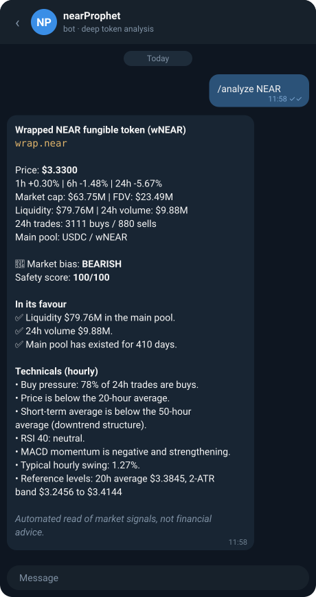
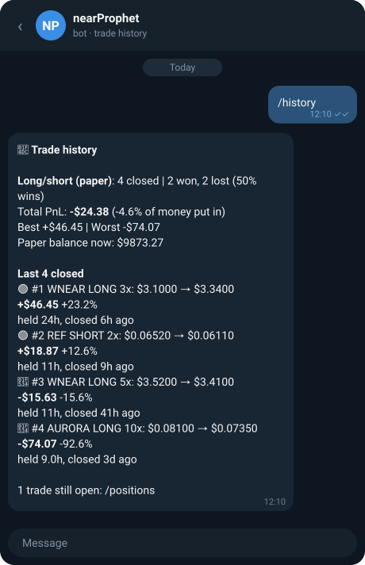
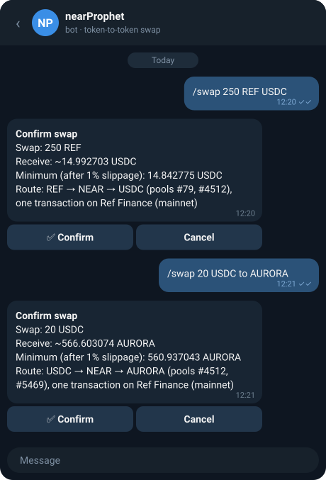
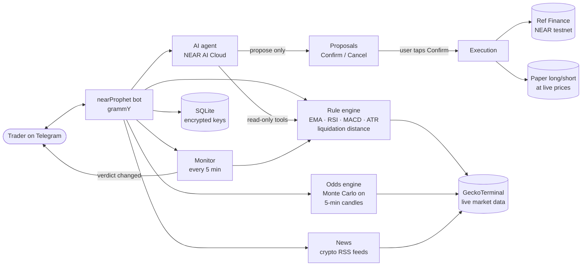
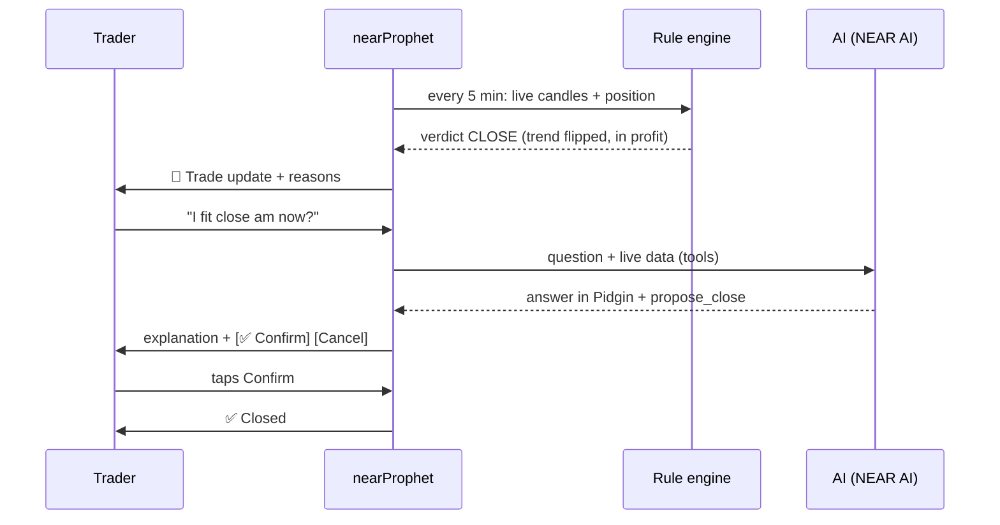

<p align="center">
  
</p>

<p align="center">
  <a href="https://t.me/NearProphetbot"></a>
  
  
  
  
</p>

**nearProphet** is a Telegram bot for trading NEAR Protocol tokens. It works like a co-pilot: it reads the market, checks your open trades every 5 minutes, warns you before liquidation, and explains every decision in the language you write in, including Nigerian Pidgin. It never moves your money on its own: every trade needs your tap on **Confirm**.

**Try it:** open [@NearProphetbot](https://t.me/NearProphetbot) in Telegram and send `/start`.

> **Also by the same author: [SwarmCompute](https://github.com/emmyloyal/swarmcompute)** ([live app](https://swarmcompute.vercel.app)). A GPU marketplace on NEAR testnet where AI agents team up to buy compute and sellers compete in a sealed-bid auction. Every buyer in a group pays the same fair price, held in on-chain escrow until delivery is verified.

---

## The problem

Trading on-chain is hard for everyday people, and it's hardest for the ones crypto says it wants to reach.

1. **Markets move while you sleep.** A leveraged trade can be liquidated at 3 a.m. Most traders find out afterwards, because no one is watching the position for them.
2. **One decision takes five apps.** A price chart, a DEX, a news site, a wallet and a calculator for liquidation prices. Beginners give up or guess.
3. **Crypto tools speak English.** Millions of new traders think and chat in Pidgin, Yoruba, Hausa, Swahili, Spanish or Arabic. Their tools don't.
4. **"AI trading bots" are either unsafe or useless.** Some trade your money on their own as a black box. Others are chatbots that make up prices because they have no live data.

## The solution

nearProphet puts the whole loop into one Telegram chat: **research → trade → monitor → decide**. The data comes from live sources and the decisions follow fixed rules; the AI only explains them. You stay in control.

| Problem | How nearProphet solves it |
|---|---|
| Markets move while you sleep | A background monitor re-checks every open trade every 5 minutes against live candles. It messages you when its verdict changes (**HOLD / TAKE PROFIT / REDUCE / CLOSE**) and warns early when liquidation is close. |
| Five apps per decision | Analysis, spot swaps on Ref Finance, long/short, open positions, news and history are all commands in one chat. A wallet is created for you with one command, with no sign-up. |
| Tools only speak English | Write in any language and the AI answers in that language. It remembers your language for alerts and reports. |
| Black-box AI | Fixed rules make the call and the AI explains it. The AI can **propose** a trade but can't execute one: you get a Confirm button. It never sees private keys. |
| Gut-feeling decisions | Scheduled **trade reports** show the trend, **estimated odds for the next 24 hours** (stop-loss, target, liquidation) and relevant news, then two or three options with price levels. You decide. |

---

## See it in action

> The images below are rendered from the bot's **real replies on live mainnet market data** (14 Nov 2026) in Telegram's dark theme. The history image uses sample trades run through the bot's real code.

<table>
  <tr>
    <td width="50%" valign="top">
      <b>Chat in any language</b> (here, Nigerian Pidgin)<br>
      <sub>The AI reads your live position, explains the rule verdict in Pidgin, and prepares the close. Nothing happens until you tap Confirm.</sub><br><br>
      
    </td>
    <td width="50%" valign="top">
      <b>Scheduled trade report</b><br>
      <sub>Verdict, hourly and 5-minute trend, 24h odds, market news, then the AI's options with price levels.</sub><br><br>
      
    </td>
  </tr>
  <tr>
    <td width="50%" valign="top">
      <b>Chat in French</b><br>
      <sub>Same live position, same rules, answered in French. The trader asks to close and gets a Confirm button.</sub><br><br>
      
    </td>
    <td width="50%" valign="top">
      <b>Chat in Spanish</b><br>
      <sub>A short this time: the rules say HOLD, the AI suggests where to move the stop, and the close still waits for Confirm.</sub><br><br>
      
    </td>
  </tr>
  <tr>
    <td width="50%" valign="top">
      <b>Deep token analysis</b><br>
      <sub>Price, liquidity, volume, buy/sell pressure, a 0–100 safety score, risk flags and technicals.</sub><br><br>
      
    </td>
    <td width="50%" valign="top">
      <b>Trade history</b><br>
      <sub>Wins and losses, total profit and loss, best and worst trade, and every closed trade.</sub><br><br>
      
    </td>
  </tr>
  <tr>
    <td width="50%" valign="top">
      <b>Swap any token for another</b><br>
      <sub>Live quotes from Ref Finance's mainnet pools (read-only). With no direct pool, the bot routes through NEAR, and both hops run in <b>one transaction</b>.</sub><br><br>
      
    </td>
    <td width="50%" valign="top">
      <b>How a swap is routed</b><br><br>
      <code>/swap 250 REF USDC</code><br><br>
      1. The bot asks Ref Finance for a <b>direct</b> REF/USDC quote.<br>
      2. It also prices <b>REF → NEAR → USDC</b> across two pools.<br>
      3. It picks whichever pays more and shows you the route, the expected amount and the minimum after slippage.<br>
      4. On <b>Confirm</b>, both hops go into one Ref transaction. Only the last hop enforces the minimum, so a bad price makes the whole swap fail and you keep your tokens.<br><br>
      Works with symbols, contract addresses, links and <code>50%</code> amounts, and the AI can propose it too ("swap half my REF to USDC").
    </td>
  </tr>
</table>

---

## Features

| | Feature | Command |
|---|---|---|
| 👛 | **Instant wallet.** A NEAR implicit account is created for each user and its key is encrypted with AES-256-GCM. | `/wallet`, `/export` |
| 👀 | **Watch your own wallet** read-only. The bot never asks for its key. | `/connect` |
| 🔎 | **Token research:** price, liquidity, volume, buys/sells, market bias, a 0–100 safety score and risk flags. Works with any NEAR token: type a symbol, or paste a contract address, a NearBlocks or Rhea link, or the `0x` address of a bridged Ethereum token. | `/token`, `/analyze` |
| 🔁 | **Spot swaps on Ref Finance** with a live quote, slippage protection and an explorer link. Swap **any token for another** in one transaction, routed through NEAR when there's no direct pool. | `/buy`, `/sell`, `/swap` |
| 📈 | **Long/short with leverage** at live prices, with liquidation price and fees. Paper money for now. | `/long`, `/short`, `/close` |
| 🛡 | **Hold-or-close verdict** for every trade, with reasons and a suggested stop-loss. | `/check`, `/positions` |
| 🔔 | **5-minute monitor:** alerts when a verdict changes, and automatic liquidation of paper trades. | automatic |
| 📊 | **Trade reports** with 24h odds and news, every N hours or on demand. | `/report` |
| 📜 | **History:** wins and losses, total profit and loss, best and worst trade, swaps. | `/history` |
| 💬 | **AI chat in any language** that reads live data and can propose trades for you to confirm. | just type |

---

## How it works



**One decision, step by step:**



### The hold-or-close rules
Checked in this order. Safety first:
1. **Liquidation risk.** How far is liquidation compared with a normal hourly price swing (ATR)? One swing away means **CLOSE (urgent)**; up to 2.5 swings means **REDUCE (urgent)**.
2. **Losing trades.** If the trend is against you (price vs EMA20/EMA50, MACD), the verdict is **REDUCE** or **CLOSE**.
3. **Winning trades.** If the trend has flipped, or the move is overstretched (high RSI, fading momentum), the verdict is **TAKE PROFIT** or **CLOSE**.

When the verdict is HOLD, the bot suggests a stop-loss 2 ATR behind the current price. The AI can explain a verdict but **can never soften an urgent one**.

### The 24-hour odds
The bot takes the last 2 days of real 5-minute price moves and replays them in random order 2,000 times. It counts how often the trade touches its stop-loss, a target 2 ATR in its favour, and liquidation, and how often it ends in profit. The moves are de-meaned, so the odds reflect how much the price swings, not a guess about its direction. Every report says they are estimates that can't foresee news or crashes.

---

## Safety by design

| Risk | Safeguard |
|---|---|
| The AI makes a trade you didn't want | The AI has **no tool that moves money**. It can only create a proposal: a Confirm/Cancel button that only you can press, works once and expires after 60 seconds. |
| The AI uses a tool it shouldn't | Each request gets an explicit allow-list of tools; any other tool call is refused. |
| Made-up prices or news | Every number comes from a live tool call in the same conversation. News comes only from fetched headlines, and the AI is told never to invent any. |
| Prompt injection through token names or headlines | All third-party text is passed as data, escaped before display, and the AI is told to ignore instructions inside it. |
| Stolen keys | Wallet keys are encrypted with AES-256-GCM and bound to their owner. The AI never sees them. `/export` works only in a private chat and deletes itself after 60 seconds. |
| Leaking trades in groups | Wallet and trade commands work only in private chat; the AI doesn't reply in groups. |
| Runaway AI costs | Each user is capped at a set number of AI replies per day (60 by default), and the 5-minute monitor uses rules only. |
| Accidental mainnet use | The bot refuses to start on mainnet unless that is explicitly enabled. Trade sizes are capped. |
| Double execution | One trade at a time per user, and a position can't be closed twice. |

## Why NEAR

- **NEAR AI Cloud:** the AI runs on NEAR's own inference platform, which offers private inference, a fit for traders' questions about their own positions.
- **Implicit accounts:** a wallet is just a key pair, so every Telegram user gets a working NEAR account instantly, with no sign-up or registration transaction.
- **Ref Finance:** NEAR's main DEX supplies the swap liquidity and quotes.
- **Fast, cheap transactions:** small, frequent trades make sense on NEAR.

---

## Engineering

- **About 3,150 lines of strict TypeScript** across 25 small modules, with only 4 runtime dependencies (`grammy`, `near-api-js`, `@anthropic-ai/sdk`, `dotenv`). The database is Node's built-in SQLite.
- **29 automated tests, about 860 lines:** leverage maths, indicators, encryption, the rule engine, the odds, news parsing, the NEAR AI adapter, and end-to-end bot flows with fake Telegram, market and NEAR network.
- **`npm run smoke`** checks the live services without keys or transactions: market data, 5-minute candles, live odds, the news feeds, the NEAR RPC and a Ref Finance quote.
- **Provider-agnostic AI:** NEAR AI Cloud by default, plus Anthropic directly or any OpenAI-compatible API.
- **Runs anywhere:** scripts for a free Google Cloud server and for a Windows PC (starts at login, restarts after crashes, daily database backups). See [DEPLOY.md](DEPLOY.md).

<details>
<summary><b>Project layout</b></summary>

```
src/
  index.ts       starts the bot and the monitor
  bot.ts         Telegram commands
  agent.ts       AI agent: chat, tools, commentary, trade proposals
  llm-openai.ts  NEAR AI / OpenAI-compatible adapter
  proposals.ts   confirm-before-execute for every money action
  advisor.ts     hold/close verdict (rules)
  forecast.ts    24h odds (bootstrap Monte Carlo on 5-min candles)
  reports.ts     scheduled and on-demand trade reports
  history.ts     closed trades, totals, swaps
  news.ts        crypto RSS headlines
  monitor.ts     5-minute background watcher and alerts
  market.ts      GeckoTerminal prices, pools, candles
  indicators.ts  EMA, RSI, MACD, ATR
  analysis.ts    token safety score and market bias
  ref.ts         Ref Finance quotes and swaps
  near.ts        wallets, balances, NEAR RPC
  crypto.ts      AES-256-GCM key encryption
  paper.ts       paper long/short venue
  perps.ts       leverage maths: liquidation price, PnL, fees
  db.ts          SQLite: users, positions, trades
  tokens.ts, lookup.ts, units.ts, format.ts, config.ts
test/            unit and end-to-end tests
scripts/         live smoke test, database backup
deploy/          Linux server and Windows PC scripts
```
</details>

---

## All commands

| Command | What it does |
|---|---|
| `/wallet` | Create or view your bot wallet, balances and paper balance |
| `/export` | Show your private key (private chat only; the message deletes itself after 60s) |
| `/connect <account>` | Watch a wallet you already own, read-only |
| `/token <symbol, contract or link>` | Price, 1h/6h/24h change, market cap, liquidity, volume, buys and sells |
| `/analyze <symbol, contract or link>` | Deep analysis: market bias, safety score, risk flags, technicals, AI read |
| `/buy <token> <NEAR>` | Quote, then Confirm. Swaps on Ref Finance |
| `/sell <token> <amount or 50%>` | Quote, then Confirm. Sells the token for NEAR |
| `/swap <amount or 50%> <from> <to>` | Token for token in one transaction, e.g. `/swap 250 REF USDC` (routed through NEAR if needed) |
| `/long <token> <$collateral> <leverage>` | Open a long (e.g. `/long NEAR $100 3`) |
| `/short <token> <$collateral> <leverage>` | Open a short |
| `/positions` | Open trades with live profit and loss |
| `/check [id]` | Live verdict: HOLD / TAKE PROFIT / REDUCE / CLOSE, with reasons |
| `/close <id>` | Close a trade |
| `/history [n]` | Closed trades, wins/losses, total profit and loss, swaps (10 by default, up to 30) |
| `/report now` | Trade report: trend, 24h odds, news, AI options |
| `/report <hours>` / `/report off` | Automatic reports every 1–24 hours (4 by default), or off |
| *any text* | Chat with the AI in any language |

Wherever a command takes a token, you can use its symbol (`REF`), contract address (`token.v2.ref-finance.near`), a NearBlocks or Rhea link, or, for tokens bridged from Ethereum, the `0x` address.

## Run your own

Requires Node 22.13 or later.
```bash
git clone https://github.com/emmyloyal/nearProphet.git && cd nearProphet
npm install
cp .env.example .env
npm run genkey      # paste the output into MASTER_KEY
# put your @BotFather token in BOT_TOKEN
# optional: a NEAR AI key in NEAR_AI_API_KEY switches on the AI
npm start
```
Get free test NEAR at https://near-faucet.io for the address `/wallet` shows. `npm test` runs the test suite, `npm run smoke` checks the live services, and [DEPLOY.md](DEPLOY.md) covers hosting.

<details>
<summary><b>AI provider options</b></summary>

| Provider | Setting | Notes |
|---|---|---|
| NEAR AI Cloud (default) | `NEAR_AI_API_KEY` | Pay per token, private inference. Claude models are sent as `anthropic/claude-...`; open models such as `deepseek/deepseek-v4.1-flash` also work. |
| Anthropic | `ANTHROPIC_API_KEY` | Adds live web search. |
| Any OpenAI-compatible API | `AI_PROVIDER=openai`, `AI_BASE_URL`, `AI_API_KEY` | OpenRouter, Groq, Gemini and others. |

Without any key, the bot runs on rules only and every command still works.
</details>

---

## Status and roadmap

**Working today on testnet:** wallets, research, Ref Finance swaps (including token-to-token routes), paper long/short at live prices, the 5-minute monitor and alerts, trade reports with odds and news, history, and AI chat in any language on NEAR AI.

**Honest limits:**
- Long/short uses **paper money**: no NEAR exchange offers perpetuals on testnet.
- Live Ref swaps are implemented and quotes are verified against the live contract, but a full swap transaction still needs an end-to-end test run.
- The news feeds hold only the last day or two of stories, so NEAR-specific headlines are often missing.
- Odds and verdicts are estimates and rules, not predictions or financial advice.

**Next:**
1. Real long/short through a perpetuals venue (e.g. NEAR perps on Hyperliquid) in place of the paper venue
2. Price alerts ("tell me when NEAR hits $4") and a paper-trading leaderboard
3. A Telegram Mini App dashboard with charts of your trades
4. NEAR-focused news sources and on-chain signals (holder concentration, funding rates)
5. A security review, then mainnet with low trade limits

---

## Author

Built by **[@emmyloyal](https://github.com/emmyloyal)**.

Also by the author: **[SwarmCompute](https://github.com/emmyloyal/swarmcompute)**, a GPU marketplace on NEAR where AI agents buy compute together through sealed-bid auctions and on-chain escrow ([live app](https://swarmcompute.vercel.app)).

<sub>nearProphet reads market signals; it doesn't know the future. Nothing here is financial advice.</sub>
